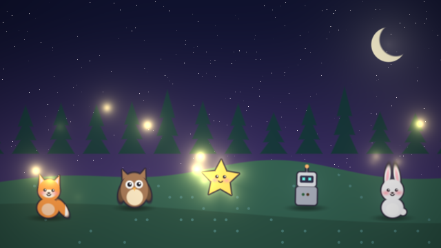

# Story Forge 🌙

A bedtime story workshop where nothing has to leave the device. A child says an idea out loud, Gemini Nano writes a short story in the browser, the Translator API makes it bilingual, the browser reads it aloud, and a WebGPU "Wonder World" draws the characters in their setting.

The app also has a **cloud engine** (Claude, through a small local server), so you can run the two **side by side** and compare speed and quality on the same prompt.

| Step | On-device engine | Cloud engine |
|---|---|---|
| Hear the idea | Web Speech `SpeechRecognition` with `processLocally` | (same, shared) |
| Write the story | Prompt API (`LanguageModel`, Gemini Nano), streamed | Claude, streamed |
| Title | Summarizer API (`headline`), falls back to the Prompt API | Claude |
| Second language | Translator API, paragraph by paragraph | Claude |
| Scene for the picture | Prompt API with `responseConstraint` (JSON schema) | Claude structured output (same schema) |
| Draw it | WebGPU SDF shader (shared) | (same, shared) |
| Read aloud | `speechSynthesis`, local voices only (shared) | (same, shared) |



Both engines get identical prompts from `public/js/shared/prompts.js`.

## Run it

```bash
npm install
```

```bash
npm start
```

Open http://localhost:5173 in desktop Chrome. To use the cloud engine, start the server with a key:

```bash
ANTHROPIC_API_KEY=sk-ant-... npm start
```

Optional: `STORYFORGE_CLOUD_MODEL` (default `claude-opus-5-5`) and `STORYFORGE_CLOUD_EFFORT` (default `low`, which keeps latency down for short stories). The key stays on the server; the browser only calls `/api/cloud/*`, which builds prompts server-side.

## Turning on the on-device pieces

Open **Engine check** in the app; it reports what this browser has. Then press **Download on-device models** (the browser downloads model weights once; no story data is involved).

- **Prompt API / Gemini Nano**: desktop Chrome 138+ on a machine that meets Google's requirements (roughly 22 GB free disk, and a GPU with more than 4 GB VRAM or 16 GB RAM). If `LanguageModel` is missing, enable `chrome://flags/#prompt-api-for-gemini-nano` and set `chrome://flags/#optimization-guide-on-device-model` to *Enabled BypassPerfRequirement*, then restart. `chrome://on-device-internals` shows the model state.
- **Translator and Summarizer APIs**: Chrome 138+. Each language pair downloads separately.
- **On-device speech recognition**: Chrome 139+ (`SpeechRecognition.available({ processLocally: true })`). If it isn't available, the mic stays off by default so audio never leaves the device; you can type instead, or allow the browser's cloud speech service in Settings.
- **Read aloud** only uses voices installed on the device (`voice.localService`). If there is no local voice for the second language, that part is skipped.
- **WebGPU**: on by default in desktop Chrome. Without it, a simple 2D fallback draws the scene.

## Privacy ledger

Every off-device request goes through `egressFetch` in `public/js/privacy.js`. The badge in the header counts them, and clicking it lists exactly what was sent and when. In on-device mode it should stay at "Nothing has left this device". Preferences and the story shelf live in this browser's `localStorage` only.

## Layout

```
server.js                     static server + /api/cloud/* (Anthropic SDK)
public/index.html, styles.css
public/js/app.js              UI, pipeline, metrics, shelf
public/js/shared/prompts.js   prompts, scene schema, validation (shared with server)
public/js/engines/ondevice.js Prompt / Summarizer / Translator APIs
public/js/engines/cloud.js    streaming client for the server
public/js/speech.js           speech recognition + read-aloud
public/js/privacy.js          egress ledger
public/js/world/              WebGPU renderer + WGSL shader, 2D fallback
test/                         node:test unit and server tests (cloud client mocked)
```

```bash
npm test
```

## Known limits

- Chrome-only and hardware-dependent; the on-device path won't run on most phones yet.
- Gemini Nano is a small model: expect simpler stories and occasional odd JSON (scene output is validated and falls back to a keyword guess).
- The Wonder World has 14 character kinds (fox, bunny, bear, cat, owl, dragon, robot, fish, unicorn, child, star, ghost, mouse, turtle) and 8 settings; anything else maps to the closest match.
